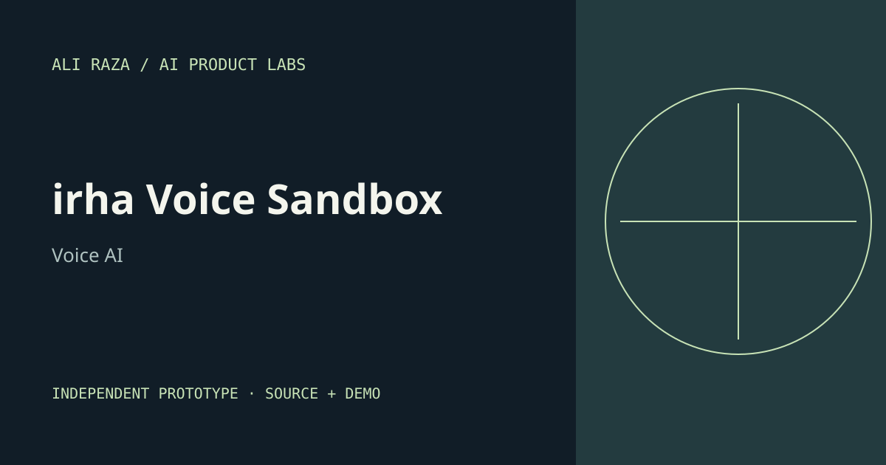

# irha Voice Sandbox



An independent public sandbox for local speech transcription, service intake, clarification, quote review, and human handoff using fictional records.

**[Working browser demo](https://aliraza2025.github.io/irha-voice-sandbox/)** · [Case study](CASE_STUDY.md) · [Portfolio copy](PORTFOLIO.md)

Stage: independent working prototype by Ali Raza, with AI-assisted implementation.

## What is verified

Local Whisper transcription and LiveKit toolset. Tests and original synthetic fixtures are included. Public browser examples are labeled separately from local framework/model execution.

## Run the workbench

Requires Node.js 22 or newer. Python integrations were verified with Python 3.13 on Apple Silicon.

```bash
# No npm dependencies are required for the browser baseline.
npm test
npm run build
npm start
```

Try a request with missing details, a request for a person, and a quote with 20 exterior windows and two stories. Confirm a draft explicitly. Record or upload audio and click Transcribe locally after installing Python requirements. `scripts/livekit_agent.py` defines the optional self-hosted LiveKit toolset.

## Optional local Python integration

```bash
python3 -m venv .venv
.venv/bin/python -m pip install -r requirements.txt
PYTHON_BIN="$PWD/.venv/bin/python" npm start
```

The first model run downloads public weights to `.model-cache/`. No paid provider is configured. Model licenses are separate from this repository's MIT source-code license. Only use recordings and documents you have permission to process.

## Boundaries

A local English synthetic recording was transcribed successfully. The LiveKit Agent class and quote tool were instantiated, but no live room, telephony call, or external booking was tested. The browser microphone and local speech controls depend on browser support. This sandbox is not the commercial irha service implementation.

The records, prices, and stories supplied with this project are synthetic. No customers, adoption, revenue, business savings, regulatory certification, or production reliability are claimed.

## Foundation and original contribution

Foundation: https://github.com/livekit/agents. The original contribution is the domain workflow, interface, validation, synthetic fixtures, tests, and product reasoning in this repository. Dependencies retain their licenses and are not represented as authored here.

The original browser source is in `public/`. `docs/` is generated for GitHub Pages; run `npm run build` after changing the browser source. Local services bind to loopback. Model endpoints are not exposed through GitHub Pages.

## Next validation

Connect a self-hosted LiveKit room and local STT/LLM/TTS, then measure turn latency, interruption handling, and task completion.

License: [MIT](LICENSE) for this repository's original source. See each dependency and model card for their respective terms.
